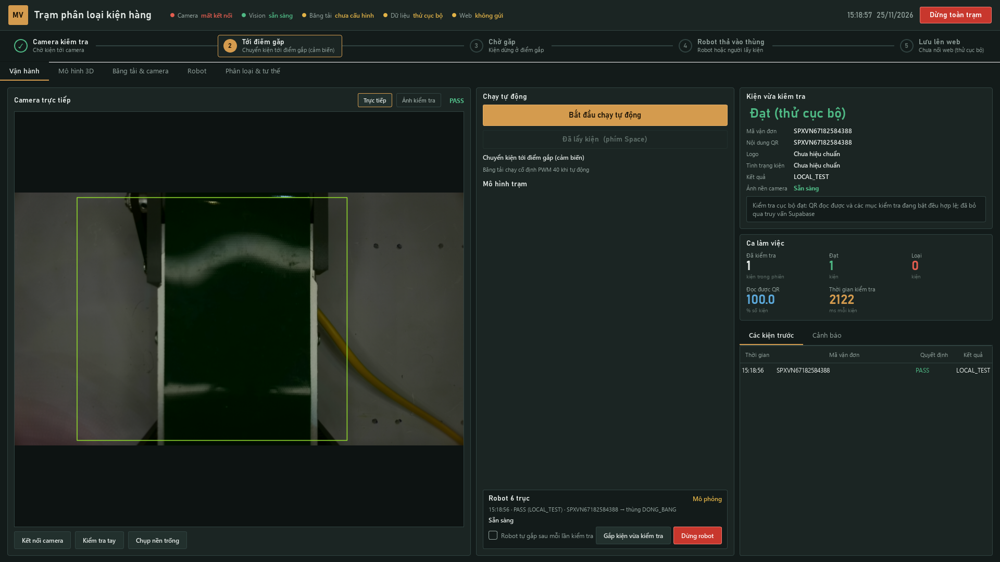
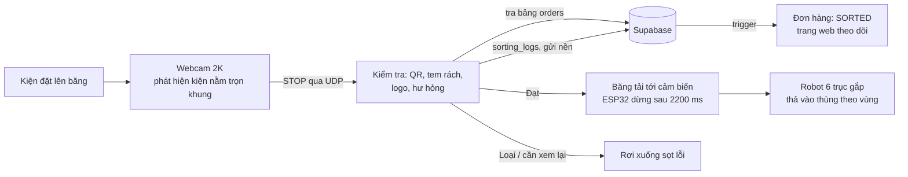

# Hệ thống phân loại kiện hàng: Vision + băng tải + cánh tay robot 6 trục


Trạm phân loại kiện hàng thương mại điện tử tự động:
1. Webcam 2K đọc mã QR trên tem vận đơn và kiểm tra tem, logo, tình trạng thùng.
2. Băng tải do ESP32 điều khiển đưa kiện đạt tới điểm gắp.
3. Cánh tay robot 6 trục in 3D gắp kiện thả vào thùng theo vùng giao hàng.
4. Kết quả từng kiện được ghi lên web (Supabase), đơn hàng tự chuyển sang trạng thái `SORTED`.



*Trang Vận hành: camera, nút chạy tự động, mô hình trạm, kết quả kiện và dải hành trình kiện 1–5 (Camera kiểm tra → Tới điểm gắp → Chờ gắp → Robot thả vào thùng → Lưu lên web). Ảnh dựng từ phần mềm, khung mô hình 3D trống vì chụp không có OpenGL.*

## Cách hệ thống hoạt động



| Thư mục | Nội dung |
|---|---|
| [`Webcamandconveyor/too/MachineVision/`](Webcamandconveyor/too/MachineVision/README.md) | **Vision + băng tải + web**: pipeline nhận dạng (QR ZXing, logo SIFT+RANSAC, tem rách, hư hỏng), chu trình tự động camera → điểm gắp, gửi kết quả lên Supabase, firmware ESP32 + W5500 (v2.1), GUI PyQt6 |
| [`robotarm-6-axis/`](robotarm-6-axis/README.md) | **Cánh tay robot 6 trục**: firmware ESP32-S3 + TMC2209, GUI điều khiển + digital twin, động học PoE lấy từ CAD, toàn bộ CAD in 3D |
| [`SortingStation/`](SortingStation/README.md) | **Trạm hợp nhất**: một ứng dụng ghép Vision, băng tải và robot; digital twin toàn trạm; bộ tuần tự gắp – thả vào 3 thùng theo vùng giao hàng |

Giữ nguyên cấu trúc thư mục: SortingStation tìm 2 phần còn lại theo đường dẫn tương đối trong `SortingStation/config/station.yaml`.

## Kết quả

**Chạy trên băng tải thật** (25/11/2026). Mỗi lần chạy tự động được ghi lại và phát lại được qua code:

| Tình huống | Kết quả |
|---|---|
| Băng trống, đèn phản chiếu trên mặt băng bóng | Không dừng nhầm |
| Kiện tốt, tem mới (2 mã vận đơn) | Tất cả PASS, đọc QR 100% |
| Kiện lỗi: tem rách mất QR, QR rách, QR mờ, QR in nhòe | Tất cả REJECT, rơi đúng sọt lỗi |
| Kiện đặt chéo, dài hơn khung camera | Vẫn được dừng và kiểm tra |
| Hai kiện đặt sát nhau, kiện sau bị cuốn qua camera | Băng chạy lùi đưa kiện về kiểm tra: 3/3 PASS |
| Tốc độ PWM 30 / 40 / 50 | Dừng và kiểm tra đúng; vận hành cố định PWM 40 |
| Ghi lên web | Trigger chuyển đơn sang `SORTED` đã kiểm trên database thật |

**Kiểm thử tự động: 206 test đạt.**
- MachineVision 184: thuật toán ảnh, phân loại, giao tiếp UDP, chu trình tự động với ESP32 giả lập, gửi kết quả lúc mất mạng, và 52 ca phát lại từ băng thật.
- SortingStation 22: mô hình robot, IK, bộ tuần tự gắp – thả.

Chi tiết từng lỗi tìm thấy và cách sửa nằm trong `logs/CHANGELOG.md` của từng thư mục.

## Cài đặt (Windows, Python 3.12)

```powershell
python -m venv .venv
.\.venv\Scripts\python.exe -m pip install -r robotarm-6-axis\requirements.txt
.\.venv\Scripts\python.exe -m pip install -e "Webcamandconveyor\too\MachineVision[dev,database]"
```

Đặt `.venv` ở thư mục gốc repo, vì `SortingStation\run_station.bat` gọi `..\.venv`.

Để ghi kết quả lên web, tạo `Webcamandconveyor\too\MachineVision\.env` từ `.env.example` (URL và key Supabase). Thiếu file này, phần mềm vẫn chạy ở chế độ thử cục bộ.

## Chạy

| Việc | Lệnh (từ thư mục gốc repo) |
|---|---|
| Trạm hợp nhất | `SortingStation\run_station.bat` |
| Hướng dẫn vận hành từng bước | [`SortingStation/docs/HUONG_DAN_VAN_HANH.md`](SortingStation/docs/HUONG_DAN_VAN_HANH.md) |
| GUI robot riêng | `cd robotarm-6-axis` rồi `..\.venv\Scripts\python.exe main.py` |
| GUI Vision riêng | `cd Webcamandconveyor\too\MachineVision` rồi `..\..\..\.venv\Scripts\python.exe -m machine_vision.app --config config\default.yaml` |
| Test SortingStation | `cd SortingStation` rồi `..\.venv\Scripts\python.exe -m pytest -q` |
| Test MachineVision | `cd Webcamandconveyor\too\MachineVision` rồi `..\..\..\.venv\Scripts\python.exe -m pytest -q` |
| Nạp firmware băng tải | Arduino IDE, xem `Webcamandconveyor/too/MachineVision/firmware/conveyor_sensor/NAP_FIRMWARE.md` |

## Không có trong repo

| Thứ | Lý do |
|---|---|
| `.env` (khóa Supabase) | Bảo mật. Tạo từ `.env.example`. ID project Supabase trong tài liệu được thay bằng `<project-id>` |
| Ảnh kiện, ảnh tem, dataset, bản ghi chạy băng tải | Tem in họ tên, địa chỉ, số điện thoại người nhận. Các test phát lại được bỏ qua khi thiếu bộ ảnh |
| Trọng số model Hugging Face | Tải lại được |
| File STEP lớn hơn 100 MB | Vượt giới hạn của GitHub; có bản nén `.step.zip` (lắp ráp robot trong `assets/CAD_lap_rap_v3/`, lắp ráp toàn trạm trong `assets/CAD_tram_tong/`) |

## Tác giả

Nguyễn Hoàng Khánh
