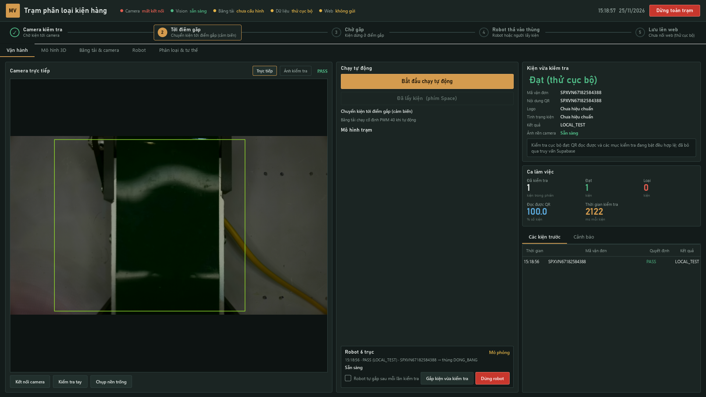

# SortingStation — Trạm phân loại kiện hàng hợp nhất

Ghép hai giao diện có sẵn thành **một ứng dụng PyQt6**:

| Nguồn | Vị trí (giữ nguyên, không di chuyển) | Vai trò trong app chung |
|---|---|---|
| MachineVision (camera, QR, logo, tem, băng tải ESP32 UDP, chu trình tự động, gửi Supabase) | `..\Webcamandconveyor\too\MachineVision` | Trang Vận hành, tab Băng tải & camera |
| GUI robot 6 trục AURA-6 (jog, MoveL, USB/LAN, lưu gốc) | `..\robotarm-6-axis` (bản chạy của `Changes\`) | Tab Robot |
| Digital twin toàn trạm + bộ tuần tự phân loại | `sorting_station\` | Tab Mô hình 3D, Phân loại & tư thế; mô hình thu gọn và thẻ Robot trên trang Vận hành |

GUI robot chỉ sửa 1 chỗ trong `main.py` (đường dẫn URDF tuyệt đối, xem `logs\CHANGELOG.md`).

**Hướng dẫn vận hành từng bước, kể cả quay video demo: [docs/HUONG_DAN_VAN_HANH.md](docs/HUONG_DAN_VAN_HANH.md).**

## Chạy

```bat
E:\UDMT\SortingStation\run_station.bat
```

hoặc `E:\UDMT\.venv\Scripts\python.exe -m sorting_station.app` từ thư mục `SortingStation`.
Môi trường Python dùng chung: `E:\UDMT\.venv` (Python 3.12, PyQt6, PyVista/VTK, OpenCV-contrib 4.10, zxing-cpp, pyserial).

Không có camera / robot / băng tải vẫn mở được: robot chạy **MÔ PHỎNG** (chỉ twin), băng tải ở trạng thái UNKNOWN.

## Giao diện (25/11/2026)



- **Thanh tiêu đề**: trạng thái Camera, Vision, Băng tải, Robot, Dữ liệu, Web; đồng hồ; nút **Dừng toàn trạm** (lệnh phần mềm, không thay dừng khẩn phần cứng).
- **Dải hành trình kiện 1–5**: Camera kiểm tra → Tới điểm gắp → Chờ gắp → Robot thả vào thùng → Lưu lên web. Bước đang chạy sáng màu kraft.
- **Vận hành**: camera | chạy tự động (Bắt đầu, Đã lấy kiện/Space, mô hình trạm, thẻ Robot 6 trục) | kiện vừa kiểm tra, ca làm việc, các kiện trước.
- **Mô hình 3D**: twin lớn (mesh CAD thật của robot, băng tải, giá camera, 3 thùng). Robot hiển thị góc **thực** (telemetry ESP32-S3) khi còn mới (< 0.5 s), ngược lại hiển thị góc **lệnh**.
- **Băng tải & camera**: chạy băng tay (kiểm tra kết nối, tiến/lùi/dừng có ACK), chỉ số độ nét, lấy mẫu logo.
- **Robot**: GUI robot gốc, dùng chung giao diện trạm; động học đã thay bằng mô hình khớp với twin.
- **Phân loại & tư thế**: nhật ký chu trình, bảng tư thế, dạy tư thế, kiểm tra tầm với, tốc độ.
- Lăn chuột không làm đổi thanh trượt hay ô số (tránh jog khớp robot ngoài ý muốn).

## Luồng phân loại

1. Chạy tự động: camera dừng kiện và kiểm tra → PASS / REJECT / MANUAL_REVIEW + `destination_bin` (sọt của đơn trong Supabase). Kiện PASS chạy tới cảm biến điểm gắp, robot bắt đầu khi ESP32 dừng băng ở đó; kiện khác rơi xuống sọt lỗi ở cuối băng.
2. Ánh xạ sang 3 thùng (`sorting.destination_map`, `decision_map` trong `config\station.yaml`):
   - `DONG_BANG` (Đồng bằng): kiện PASS thuộc hub 1 (Hà Nội), 3 (Hải Phòng - Quảng Ninh), 5 (Nam Định - Thanh Hóa).
   - `TRUNG_DU` (Trung du - miền núi): kiện PASS thuộc hub 2 (Bắc Ninh - Bắc Giang - Lạng Sơn), 4 (Thái Nguyên - Phú Thọ).
   - `LOI` (Lỗi): kiện REJECT, MANUAL_REVIEW, hub 0 hoặc hub không có trong bảng. Database vẫn phân biệt hỏng / cần xem lại ở `sorting_logs.decision`.
3. Nếu bật **Tự động sau KIỂM TRA** (hoặc nhấn **PHÂN LOẠI**): băng tải FWD `conveyor_transfer_s` giây → STOP (chờ ACK) → robot: trên điểm gắp → hạ → HÚT → nhấc → trên thùng → hạ → NHẢ → TẮT → về HOME.

Trước khi chạy robot thật bắt buộc: đã **Lưu Gốc**, có telemetry, góc thực khớp góc lệnh, băng tải ONLINE (nếu dùng băng tải). Mọi tư thế được giải IK và kiểm tra giới hạn khớp trước khi robot cử động; robot không bám telemetry trong `settle_timeout_s` → dừng khẩn.

## Hiệu chuẩn trước khi chạy thật (bắt buộc)

1. Đo `robot.tool_length_mm` (đầu hút) và bố trí thực (`layout`) — giá trị hiện tại là ước lượng.
2. Tab ROBOT: jog robot tới điểm gắp thật → tab PHÂN LOẠI chọn `pick` → **GHI TƯ THẾ ROBOT HIỆN TẠI**. Lặp lại cho `bin:DONG_BANG`, `bin:TRUNG_DU`, `bin:LOI`. Tư thế dạy lưu ở `config\taught_poses.json`.
3. Đo thời gian băng tải đưa kiện từ camera tới điểm gắp ở PWM đang dùng → `conveyor_transfer_s`.
4. Chạy thử từng chu trình ở tốc độ thấp (10–15 °/s), tay đặt sẵn trên công tắc ngắt nguồn động lực.

## Kiểm thử

```bat
cd /d E:\UDMT\SortingStation
..\.venv\Scripts\python.exe -m pytest -q tests
..\.venv\Scripts\python.exe scripts\smoke_screenshot.py
```

- `tests\test_robot_model.py`: mô hình trùng twin (sai khác 1e-16), Jacobian, IK khứ hồi, từ chối điểm ngoài tầm.
- `tests\test_sorting.py`: chu trình mô phỏng/thật với robot & băng tải giả lập, thiếu ACK, robot không bám, chưa lưu gốc, dạy tư thế.
- `scripts\smoke_screenshot.py`: mở GUI thật, chạy 1 chu trình mô phỏng, chụp ảnh các tab vào `reports\screenshots`.

## Cấu trúc

```
SortingStation\
  config\station.yaml        đường dẫn, kết nối robot, bố trí trạm, tham số phân loại
  sorting_station\
    app.py                   khởi động
    main_window.py           cửa sổ hợp nhất (kế thừa MainWindow của MachineVision)
    robot_model.py           FK/IK PoE từ trục khớp CAD (thay DH lệch)
    robot_bridge.py          nhúng GUI robot + API điều khiển + telemetry không chặn
    cell_state.py            trạng thái chung của trạm
    cell_twin.py             digital twin PyVista toàn trạm
    sorting.py               lập kế hoạch tư thế + bộ tuần tự gắp–thả
    sorting_panel.py         giao diện phân loại
  tests\  scripts\  reports\  logs\
```
