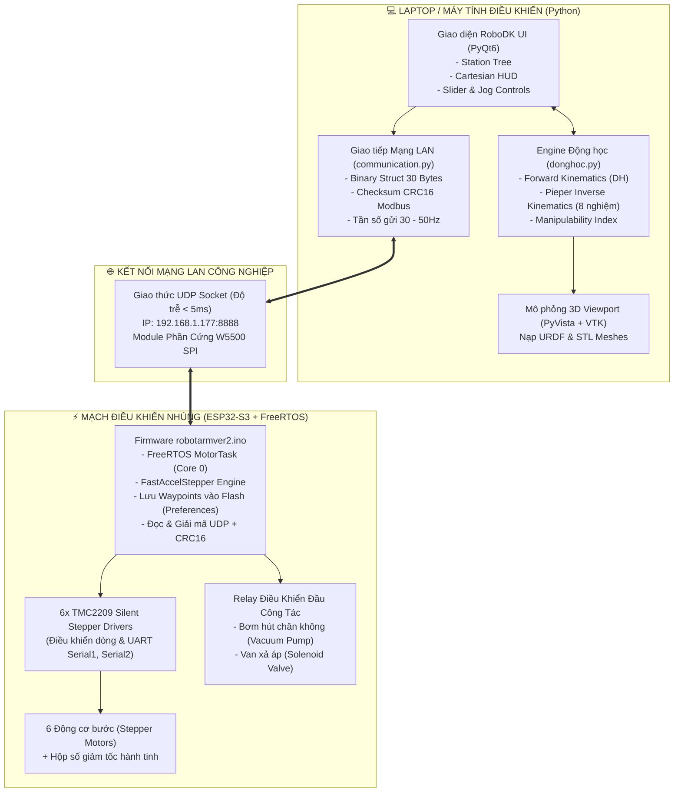

# 🤖 6-DOF Industrial Robot Arm Control & Digital Twin System

> **Hệ thống điều khiển, mô phỏng 3D Digital Twin thời gian thực và tự động hóa cho Cánh tay Robot 6 Bậc Tự Do (6-Axis Robotic Arm).**  
> Dự án được phát triển theo tiêu chuẩn công nghiệp với giao diện mô phỏng phong cách RoboDK CAD/CAM, giải thuật động học hình học giải tích (Pieper Closed-Form IK), giao thức mạng Ethernet công nghiệp W5500 độ trễ cực thấp và firmware điều khiển động cơ bước vi bước TMC2209 trên vi điều khiển kép ESP32-S3.

[](https://www.python.org/)
[](https://riverbankcomputing.com/software/pyqt/)
[](https://www.pyvista.org/)
[](https://www.espressif.com/)
[](https://www.wiznet.io/)

---

## 📑 Mục Lục
- [1. Tổng Quan Kiến Trúc Hệ Thống](#1-tổng-quan-kiến-trúc-hệ-thống)
- [2. Cấu Trúc Thư Mục Dự Án](#2-cấu-trúc-thư-mục-dự-án)
- [3. Mô Hình Động Học & Thông Số Cơ Khí](#3-mô-hình-động-học--thông-số-cơ-khí)
- [4. Giao Thức Mạng Truyền Thông UDP (Binary Packet + CRC16)](#4-giao-thức-mạng-truyền-thông-udp-binary-packet--crc16)
- [5. Sơ Đồ Đấu Nối Phần Cứng (Hardware Pinout)](#5-sơ-đồ-đấu-nối-phần-cứng-hardware-pinout)
- [6. Hướng Dẫn Cài Đặt & Vận Hành (Quickstart)](#6-hướng-dẫn-cài-đặt--vận-hành-quickstart)
- [7. Hướng Dẫn Chi Tiết Cho Thành Viên Trong Team Tiếp Tục Phát Triển](#7-hướng-dẫn-chi-tiết-cho-thành-viên-trong-team-tiếp-tục-phát-triển)
  - [Lộ trình 1: Hoàn thiện Quy hoạch Quỹ đạo (`trajectory.py`)](#lộ-trình-1-hoàn-thiện-quy-hoạch-quỹ-đạo-trajectorypy)
  - [Lộ trình 2: Bộ dịch mã G-Code (`gcode_parser.py`)](#lộ-trình-2-bộ-dịch-mã-g-code-gcode_parserpy)
  - [Lộ trình 3: Nâng cấp Giao diện & Trạm Dạy học (Teach Pendant & Station Tree)](#lộ-trình-3-nâng-cấp-giao-diện--trạm-dạy-học-teach-pendant--station-tree)
  - [Lộ trình 4: An toàn & Homing Cảm biến trên Firmware](#lộ-trình-4-an-toàn--homing-cảm-biến-trên-firmware)
- [8. Quy Chuẩn Đóng Góp (Git Workflow & Code Standards)](#8-quy-chuẩn-đóng-góp-git-workflow--code-standards)

---

## 1. Tổng Quan Kiến Trúc Hệ Thống

Hệ thống được thiết kế phân tầng theo mô hình **Digital Twin / HMI - Controller - Actuator**:



---

## 2. Cấu Trúc Thư Mục Dự Án

```
robotarm-6-axis/
├── .gitignore                      # File cấu hình bỏ qua file rác, venv, cache
├── requirements.txt                # Danh sách thư viện Python cần cài đặt
├── README.md                       # Tài liệu hướng dẫn toàn diện dự án
├── main.py                         # Điểm khởi chạy chương trình chính (Main Entrypoint)
├── donghoc.py                      # Module tính toán Động học (FK, Pieper IK, Ma trận DH, CRC16)
├── communication.py                # Module Socket UDP, đóng gói dữ liệu nhị phân gửi/nhận
├── robot_simulation.py             # Widget mô phỏng 3D nhúng PyVista nạp từ URDF
├── robotarm.py                     # File UI phụ (Legacy)
├── viewmodel.py                    # Script thử nghiệm mô phỏng URDF độc lập
├── visualization.py                # Script thử nghiệm mô phỏng file STL trực tiếp
├── trajectory.py                   # [Đang phát triển] Lập kế hoạch quỹ đạo S-Curve / MoveJ / MoveL
├── gcode_parser.py                 # [Đang phát triển] Bộ phân tích cú pháp G-Code
├── assets/                         # Thư viện mô hình CAD, URDF và gói ROS
│   ├── CAD/                        # File STL của từng khâu (base_link, link_1 -> link_6)
│   ├── ROBOTARM2_description/      # Gói mô tả ROS Robot hoàn chỉnh
│   │   ├── meshes/                 # File STL tối ưu hóa cho mô phỏng
│   │   ├── urdf/                   # File mô hình Xacro & Gazebo
│   │   ├── launch/                 # File launch cho ROS / RViz
│   │   └── PUBY.urdf               # File URDF nạp trực tiếp vào PyVista
│   ├── Vinhne_description/         # Gói mô hình URDF dự phòng
│   └── URDF/                       # Dữ liệu xuất từ SolidWorks / Fusion 360
├── uis/                            # Mã nguồn giao diện người dùng
│   ├── robodk_ui.py                # Giao diện chính phong cách RoboDK CAD/CAM Dark Theme
│   ├── modern_ui.py                # Giao diện kiểu phẳng thay thế
│   ├── home.py                     # Giao diện được build từ file .ui
│   ├── home.ui                     # File thiết kế Qt Designer
│   └── home.qss                    # Stylesheet CSS giao diện
└── robotarmver2/                   # Mã nguồn Firmware vi điều khiển
    └── robotarmver2.ino            # Firmware C++ cho ESP32-S3 + W5500 + TMC2209
```

---

## 3. Mô Hình Động Học & Thông Số Cơ Khí

Robot là dạng **6-DOF Articulated Manipulator** có cổ tay hình cầu (Spherical Wrist: tâm 3 trục quay của Joint 4, 5, 6 cắt nhau tại 1 điểm).

### 3.1. Kích thước hình học thực tế (Đơn vị: Mét)
- $d_1 = 0.130\,\text{m}$ (130mm): Khoảng cách từ mặt đế đến trục khớp 2 (Vai).
- $a_2 = 0.155\,\text{m}$ (155mm): Chiều dài link cánh tay trên (Khớp 2 đến Khớp 3).
- $d_3 = 0.150\,\text{m}$ (150mm): Đoạn đầu cánh tay trước.
- $d_4 = 0.120\,\text{m}$ (120mm): Đoạn tới tâm cổ tay. $\rightarrow d_3 + d_4 = 0.270\,\text{m}$ (270mm).
- $d_6 = 0.040\,\text{m}$ (40mm): Khoảng cách từ tâm cổ tay đến điểm Tool TCP.

### 3.2. Bảng thông số D-H chuẩn (Standard Denavit-Hartenberg)

| Khớp $i$ | $a_i$ (m) | $\alpha_i$ (rad) | $d_i$ (m) | $\theta_i$ (Offset) | Giới hạn góc ($^\circ$) | Ghi chú |
| :---: | :---: | :---: | :---: | :---: | :---: | :--- |
| **1** | $0$ | $-\pi/2$ | $0.130$ | $0$ | $[-170^\circ, +170^\circ]$ | Khớp xoay đế (Base Yaw) |
| **2** | $0.155$ | $0$ | $0$ | $0$ | $[-90^\circ, +110^\circ]$ | Khớp nâng vai (Shoulder Pitch) |
| **3** | $0$ | $-\pi/2$ | $0$ | $0$ | $[-150^\circ, +150^\circ]$ | Khớp gập khuỷu (Elbow Pitch) |
| **4** | $0$ | $+\pi/2$ | $0.270$ | $0$ | $[-180^\circ, +180^\circ]$ | Khớp xoay trục cẳng tay (Wrist Roll) |
| **5** | $0$ | $-\pi/2$ | $0$ | $0$ | $[-110^\circ, +110^\circ]$ | Khớp uốn cổ tay (Wrist Pitch) |
| **6** | $0$ | $0$ | $0.040$ | $0$ | $[-360^\circ, +360^\circ]$ | Khớp xoay đầu công tác (Wrist Yaw) |

### 3.3. Giải thuật Động học nghịch Pieper (Pieper Closed-Form IK)
File `donghoc.py` tích hợp bộ giải toán học giải tích:
1. Xác định tọa độ **Tâm cổ tay (Wrist Center $P_w$)**:  
   $$P_w = P_{\text{target}} - d_6 \cdot Z_{\text{end}}$$
2. Giải 2 nghiệm $q_1$ dựa trên vị trí hình chiếu $P_w$ trên mặt phẳng XY.
3. Giải góc khuỷu $q_3$ (nghiệm Elbow Up / Elbow Down) từ định lý hàm cos tam giác tạo bởi $a_2$, $(d_3+d_4)$ và khoảng cách từ gốc vai đến $P_w$.
4. Giải góc vai $q_2$ tương ứng với từng cặp $(q_1, q_3)$.
5. Tính ma trận quay phần cổ tay: $R_{36} = R_{03}^T \cdot R_{\text{target}}$.
6. Tách góc Euler $Z-Y-Z$ để tìm $(q_4, q_5, q_6)$, tự động xử lý điểm kỳ dị cổ tay (Wrist Singularity khi $q_5 = 0$).
7. Lựa chọn bộ nghiệm hợp lệ (nằm trong Joint Limits) gần nhất với tư thế hiện tại của robot (tránh giật chuyển động).

---

## 4. Giao Thức Mạng Truyền Thông UDP (Binary Packet + CRC16)

Dữ liệu truyền nhận giữa Laptop và ESP32-S3 sử dụng định dạng **Nhị phân nén chặt (Binary Struct - Byte Packed)**, tối ưu tuyệt đối về tốc độ và loại bỏ độ trễ phân tích chuỗi JSON / Text.

### 4.1. Gói tin Lệnh từ Laptop $\rightarrow$ ESP32-S3 (`RobotCommandPacket` - 30 Bytes)

| Offset (Bytes) | Tên trường | Kiểu dữ liệu | Mô tả |
| :---: | :--- | :--- | :--- |
| `0 - 1` | `header` | `uint16_t` (2B) | Magic Byte cố định: `0xAA55` |
| `2` | `command_type` | `uint8_t` (1B) | `0`: Dừng khẩn (`CMD_STOP`)<br>`1`: Chạy trực tiếp (`CMD_MOVE_PC`)<br>`2`: Lưu Waypoint (`CMD_REC_WP`)<br>`3`: Chạy tự động (`CMD_PLAY_AUTO`)<br>`4`: Chỉ bật tool (`CMD_TOOL_ONLY`) |
| `3` | `tool_state` | `uint8_t` (1B) | `0`: Tắt (`OFF`)<br>`1`: Hút chân không (`SUCK`)<br>`2`: Thổi nhả phôi (`RELEASE`)<br>`255`: Xóa sạch bộ nhớ Flash |
| `4 - 27` | `target_angles`| `float[6]` (24B) | 6 số thực 32-bit (Little-Endian) góc của 6 khớp ($J_1 \rightarrow J_6$) tính bằng Độ ($^\circ$) |
| `28 - 29` | `crc16` | `uint16_t` (2B) | Mã kiểm tra lỗi CRC16-Modbus (Polynomial `0xA001`) |

### 4.2. Gói tin Phản hồi từ ESP32-S3 $\rightarrow$ Laptop (`RobotFeedbackPacket` - 30 Bytes)

| Offset (Bytes) | Tên trường | Kiểu dữ liệu | Mô tả |
| :---: | :--- | :--- | :--- |
| `0 - 1` | `header` | `uint16_t` (2B) | Magic Byte cố định: `0x55AA` |
| `2` | `robot_mode` | `uint8_t` (1B) | `0`: MODE_PC (Điều khiển trực tiếp), `1`: MODE_AUTO (Chạy quỹ đạo) |
| `3` | `current_tool` | `uint8_t` (1B) | Trạng thái hiện tại của Tool (0: OFF, 1: HÚT, 2: NHẢ) |
| `4 - 27` | `actual_angles`| `float[6]` (24B) | 6 góc thực tế của 6 khớp quy đổi từ số xung bước hiện tại |
| `28 - 29` | `crc16` | `uint16_t` (2B) | Mã kiểm tra lỗi CRC16-Modbus |

---

## 5. Sơ Đồ Đấu Nối Phần Cứng (Hardware Pinout)

### 5.1. Vi điều khiển trung tâm: **ESP32-S3 Dev Module**

- **Module Ethernet W5500 (Giao tiếp phần cứng SPI):**
  - `SCK` $\rightarrow$ GPIO 13
  - `MISO` $\rightarrow$ GPIO 12
  - `MOSI` $\rightarrow$ GPIO 11
  - `CS` $\rightarrow$ GPIO 10
  - Cấu hình mạng mặc định: IP `192.168.1.177`, Port `8888`.

- **6 Driver Stepper TMC2209 (Giao tiếp xung & UART):**
  - **Chân Enable chung (Tất cả 6 Driver):** GPIO 14 (`LOW` = Kích hoạt motor).
  - **Cụm Khớp 1, 2, 3 (Serial1 Hardware UART):**
    - `RX1`: GPIO 17, `TX1`: GPIO 18
    - Driver 0 (J1): Step = GPIO 1, Dir = GPIO 2, Address = 0
    - Driver 1 (J2): Step = GPIO 4, Dir = GPIO 5, Address = 1
    - Driver 2 (J3): Step = GPIO 6, Dir = GPIO 7, Address = 2
  - **Cụm Khớp 4, 5, 6 (Serial2 Hardware UART):**
    - `RX2`: GPIO 8, `TX2`: GPIO 9
    - Driver 3 (J4): Step = GPIO 15, Dir = GPIO 16, Address = 0
    - Driver 4 (J5): Step = GPIO 40, Dir = GPIO 41, Address = 1
    - Driver 5 (J6): Step = GPIO 38, Dir = GPIO 39, Address = 2

- **Rơ-le Điều khiển Công tác Chân Không (Tool End-Effector):**
  - Bơm hút chân không (Vacuum Pump): Relay Pin GPIO 10
  - Van xả áp phôi (Solenoid Release Valve): Relay Pin GPIO 11

### 5.2. Thông số Cơ điện Động cơ
- Vi bước (Microstepping): $16$ vi bước.
- Số bước nguyên 1 vòng: $200$ steps ($1.8^\circ/\text{step}$).
- Dòng hoạt động cài đặt TMC2209 (`MOTOR_CURRENTS`): `[1000mA, 350mA, 350mA, 350mA, 1000mA, 1000mA]`.
- Tỉ số truyền hộp số (`GEAR_RATIOS`): `[1.0, 5.181818, 5.181818, 5.181818, 1.0, 1.0]`.

---

## 6. Hướng Dẫn Cài Đặt & Vận Hành (Quickstart)

### 6.1. Chuẩn bị môi trường Python trên máy tính
Khuyến nghị sử dụng **Python 3.10 trở lên** (Hỗ trợ tốt nhất trên Windows 10/11):

```bash
# 1. Clone mã nguồn từ GitHub
git clone https://github.com/Phucreat/robotarm-6-axis.git
cd robotarm-6-axis

# 2. Tạo môi trường ảo (Virtual Environment)
python -m venv .venv

# 3. Kích hoạt môi trường ảo
# Trên Windows PowerShell:
.\.venv\Scripts\Activate.ps1
# Trên Command Prompt (cmd):
.\.venv\Scripts\activate.bat

# 4. Nâng cấp pip và cài đặt toàn bộ thư viện cần thiết
python -m pip install --upgrade pip
pip install -r requirements.txt
```

### 6.2. Cấu hình IP card mạng LAN trên máy tính
1. Cắm dây mạng LAN từ Module W5500 vào cổng Ethernet của Laptop (hoặc qua Switch).
2. Vào **Network Connections** trên Windows:
   - Cài đặt IP tĩnh (Static IP): `192.168.1.100` (hoặc bất kỳ IP nào khác `.177`).
   - Subnet mask: `255.255.255.0`.
   - Default gateway: Để trống hoặc `192.168.1.1`.

### 6.3. Nạp Firmware lên ESP32-S3
1. Mở Arduino IDE (hoặc VS Code PlatformIO).
2. Mở file `robotarmver2/robotarmver2.ino`.
3. Cài đặt các thư viện sau từ Library Manager:
   - `FastAccelStepper` by lennart-k
   - `TMCStepper` by teemuatlut
   - `Ethernet` by Various
4. Chọn Board: **ESP32S3 Dev Module** (cấu hình Flash 8MB/16MB, USB CDC On Boot enabled nếu cần Serial).
5. Nhấn **Upload** để nạp code. Mở Serial Monitor (baud 115200) để kiểm tra IP mạng `192.168.1.177`.

### 6.4. Khởi chạy ứng dụng RoboDK Workcell
```bash
python main.py
```
- Nhấn nút **🌐 Connect W5500 (UDP)** trên thanh Ribbon để kết nối với robot thật.
- Điều khiển thanh trượt 6 khớp hoặc nhập tọa độ $X, Y, Z$ trong ô **MoveL** để robot tính IK và di chuyển.
- Kích đúp vào Target trong mục **Station Tree** để điều khiển robot quay về điểm đã lưu.

---

## 7. Hướng Dẫn Chi Tiết Cho Thành Viên Trong Team Tiếp Tục Phát Triển

Phần này đặc biệt dành cho các kỹ sư và lập trình viên trong nhóm để tiếp tục mở rộng dự án.

### Lộ trình 1: Hoàn thiện Quy hoạch Quỹ đạo (`trajectory.py`)
Hiện tại `trajectory.py` đang để trống. Cần triển khai các bộ tạo quỹ đạo:
1. **Nội suy không gian khớp (MoveJ Trajectory):**
   - Viết hàm nội suy đa thức bậc 5 (Quintic Polynomial) hoặc đường cong chữ S (S-curve velocity profile) giữa 2 bộ góc $q_{\text{start}}$ và $q_{\text{goal}}$.
   - Đảm bảo vận tốc đầu/cuối bằng 0, đạo hàm gia tốc (Jerk) liên tục để động cơ không bị rung giật.
2. **Nội suy không gian Descartes (MoveL & MoveC):**
   - Nội suy đường thẳng $P(t) = P_{\text{start}} + t \cdot (P_{\text{goal}} - P_{\text{start}})$.
   - Nội suy hướng sử dụng Quaternion SLERP (Spherical Linear Interpolation).
   - Chia thành $N$ điểm rời rạc (cách nhau 5-10ms), giải IK Pieper liên tục và gửi xuống qua UDP.

### Lộ trình 2: Bộ dịch mã G-Code (`gcode_parser.py`)
Mục tiêu là cho phép robot thực hiện các tác vụ vẽ hình, khắc laser hoặc in 3D:
1. Phân tích các lệnh G-Code phổ biến:
   - `G0`: Chuyển động nhanh không gia công (MoveJ tới vị trí tiếp cận).
   - `G1 X... Y... Z... F...`: Chuyển động đường thẳng cắt gọt (MoveL theo vận tốc Feedrate $F$).
   - `G2 / G3`: Nội suy cung tròn thuận / ngược chiều kim đồng hồ.
   - `M3 / M5`: Bật / Tắt đầu công tác (Vacuum hoặc Spindle/Laser).
2. Tích hợp thanh ProgressBar hiển thị tiến độ chạy file G-code trên giao diện `robodk_ui.py`.

### Lộ trình 3: Nâng cấp Giao diện & Trạm Dạy học (Teach Pendant & Station Tree)
Trong file `main.py` và `uis/robodk_ui.py`:
1. **Xuất / Nhập Trạm (Save / Load Workcell):**
   - Viết tính năng lưu toàn bộ danh sách Waypoint targets ra file định dạng `.json` hoặc `.csv`.
   - Nạp lại file chương trình vào Station Tree khi mở lại phần mềm.
2. **Jogging theo Hệ tọa độ TCP & Base:**
   - Bổ sung các nút bấm Jogging: $+X, -X, +Y, -Y, +Z, -Z$ theo từng bước (Step: 1mm, 5mm, 10mm).
3. **Phát hiện va chạm (Collision Avoidance):**
   - Sử dụng thư viện `trimesh` để kiểm tra va chạm giữa các khâu với mặt bàn làm việc hoặc các chướng ngại vật định nghĩa trong không gian 3D.

### Lộ trình 4: An toàn & Homing Cảm biến trên Firmware
Trong file `robotarmver2/robotarmver2.ino`:
1. **Quy trình về gốc chuẩn (Homing Routine):**
   - Tận dụng tính năng **StallGuard4** của TMC2209 để Homing không cần công tắc hành trình (Sensorless Homing), hoặc gắn công tắc quang/cơ vào các chân GPIO còn trống của ESP32-S3.
2. **Cơ chế Watchdog An toàn mạng (Heartbeat Timeout):**
   - Thêm bộ đếm thời gian kiểm tra: Nếu trong vòng 500ms không nhận được gói tin UDP từ PC, ESP32-S3 phải tự động kích hoạt `stopMove()` để dừng khẩn cấp phòng ngừa đứt cáp mạng.

---

## 8. Quy Chuẩn Đóng Góp (Git Workflow & Code Standards)

Để giữ cho kho mã nguồn luôn sạch sẽ, ổn định và dễ bảo trì:

1. **Quy trình phân nhánh (Branching Model):**
   - Không commit trực tiếp lên nhánh `main`.
   - Tạo nhánh tính năng mới từ `main`:
     ```bash
     git checkout -b feature/ten-tinh-nang-moi
     # hoặc sửa lỗi:
     git checkout -b fix/loi-dong-hoc-ik
     ```
2. **Quy tắc Commit Message:**
   - Viết thông điệp commit rõ ràng, mang tính hành động (bằng tiếng Anh hoặc tiếng Việt chuẩn):
     - `feat: triển khai thuật toán nội suy S-curve trong trajectory.py`
     - `fix: sửa lỗi tính góc q5 khi gặp điểm kỳ dị cổ tay`
     - `docs: cập nhật sơ đồ đấu chân ESP32-S3 và W5500`
3. **Quy chuẩn Code (PEP8):**
   - Đặt tên biến và hàm theo kiểu `snake_case` (ví dụ: `calc_ik_target()`).
   - Đặt tên Class theo kiểu `PascalCase` (ví dụ: `RobotCommunicator`).
   - Luôn bổ sung Docstrings giải thích tham số đầu vào và đầu ra của các hàm động học.

---

## 📞 Liên Hệ & Hỗ Trợ Kỹ Thuật

- **Tác giả / Quản lý dự án:** Phú (`Phucreat`)
- **Kho lưu trữ GitHub:** [https://github.com/Phucreat/robotarm-6-axis.git](https://github.com/Phucreat/robotarm-6-axis.git)
- Mọi thắc mắc hoặc báo lỗi vui lòng tạo Issue trên GitHub hoặc thảo luận trực tiếp trong nhóm dự án.
